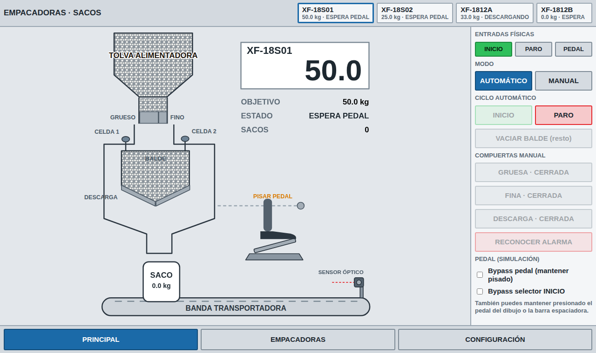
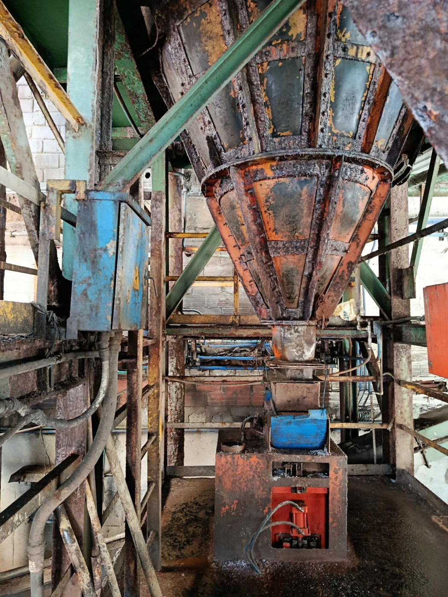
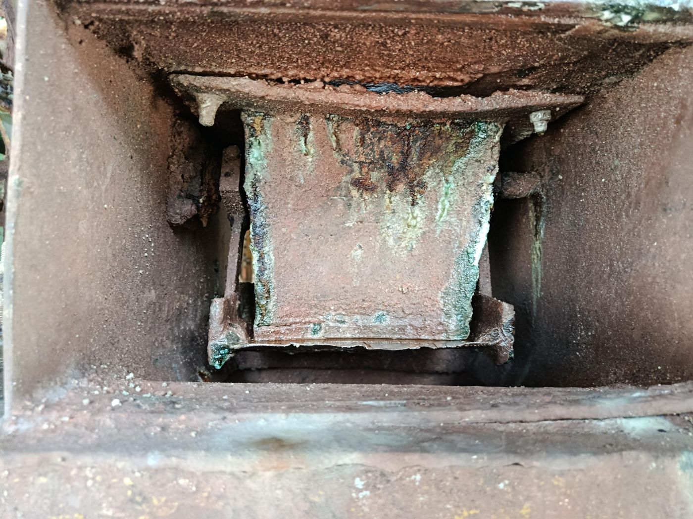
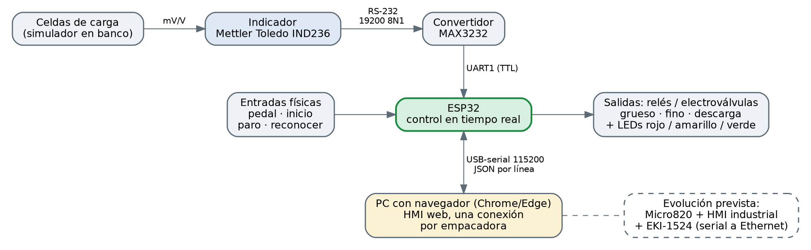
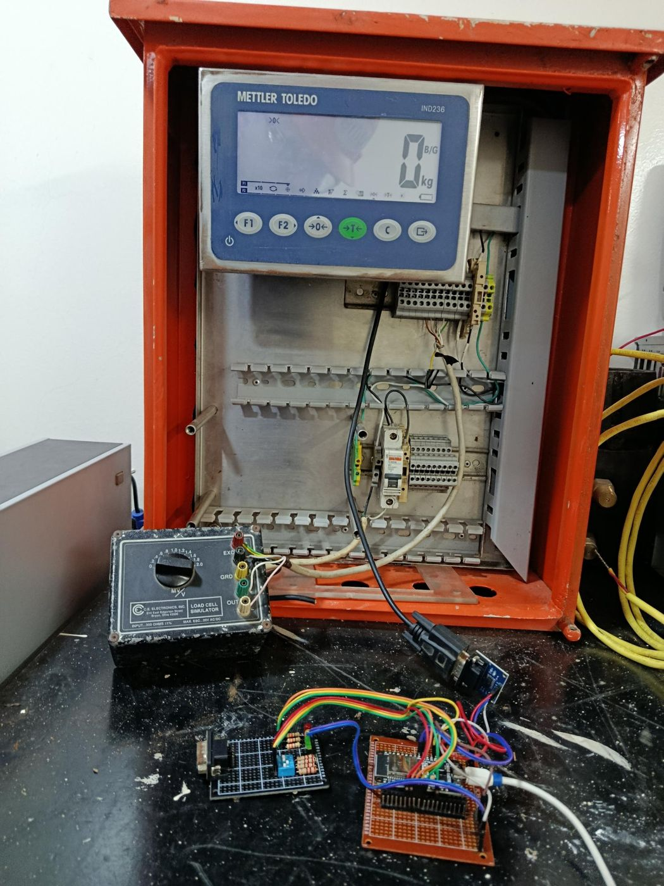

# Empacadoras de sacos: pesaje, control y HMI web

Prototipo de un sistema de **pesaje y dosificación por celdas de carga** para empacadoras de sacos de 50 kg de producto granulado (fertilizante). Reemplaza el pesaje por contrapeso y microswitch por un indicador **Mettler Toledo IND236**, un control en tiempo real con **ESP32** y una **HMI web** estilo industrial para supervisar las cuatro empacadoras.



> **Estado del proyecto:** prototipo funcional en banco (IND236 + simulador de celdas de carga + ESP32). La lógica de control se verifica en el PC con una planta simulada (`tools/pc_test`). Las **pruebas de banco con medición** y el **piloto en planta** están pendientes. Ver [docs/pruebas.md](docs/pruebas.md).

## Contexto y problema

Las empacadoras actuales pesan por contrapeso: el balde apoya en una base en U y, al vencer el contrapeso, presiona un microswitch que da por cumplidos los 50 kg. El ambiente es muy corrosivo (sales fertilizantes, polvo y humedad), los microswitches y mecanismos fallan, el peso real de cada saco no se mide ni se registra y la lógica está repartida entre microswitches, un contactor con temporizador y un PLC en cada tablero.

| | |
|---|---|
|  |  |

Más detalle y todas las fotos del diagnóstico en [docs/diagnostico-planta.md](docs/diagnostico-planta.md).

## Qué hace

- **Pesaje continuo** con el IND236 (trama Toledo por RS-232) leído por el ESP32.
- **Llenado en dos etapas:** abren grueso y fino juntos; al llegar al corte de grueso (menos su cola) cierra el grueso y sigue solo el fino hasta el objetivo (menos su cola).
- **Descarga con pedal del operador:** el pedal da el permiso; un toque inicia una descarga completa (aunque se suelte) y, si se mantiene pisado, el ciclo se repite.
- **Seguridad estilo ladder:** paro, peso inválido, sobrellenado y alarmas cierran las salidas **en el mismo ciclo de control** (10 ms), sin esperar la secuencia.
- **Modo manual / automático**, **vaciado del resto** del balde, **cero y span** por software, **bypass** del pedal y del selector de inicio.
- **HMI web** con las 4 empacadoras, esquema animado de la máquina, alarmas, configuración y una conexión serial **por empacadora** (Web Serial).
- Parámetros guardados en memoria no volátil del ESP32.



## Estructura del repositorio

```
.
├── firmware/            Código del ESP32 (C, ESP-IDF, proyecto PlatformIO)
│   ├── platformio.ini
│   ├── CMakeLists.txt
│   ├── sdkconfig.defaults
│   └── src/             main.c, control_logic.c/.h, ind236_driver.c/.h
├── hmi/                 HMI web (un solo archivo HTML)
│   └── index.html
├── tools/pc_test/       Prueba de la lógica del firmware en el PC (sin hardware)
├── docs/                Documentación, diagramas e imágenes
│   ├── conexiones.md    Hardware, pines y cableado
│   ├── firmware.md      Tareas, secuencia, enclavamientos y alarmas
│   ├── protocolo.md     Mensajes JSON entre el ESP32 y la HMI
│   ├── pruebas.md       Plan de pruebas y resultados
│   ├── diagnostico-planta.md  Fotos y hallazgos del sistema actual
│   ├── roadmap.md       Evolución prevista (PLC Micro820 + HMI industrial)
│   └── images/
└── LICENSE
```

## Inicio rápido

### 1. Firmware

Requisitos: [PlatformIO](https://platformio.org/) (extensión de VS Code) y una placa ESP32.

```bash
cd firmware
pio run                 # compilar
pio run -t upload       # cargar al ESP32
```

- La placa por defecto es `esp32dev`; cámbiala en `platformio.ini` si usas otra.
- Revisa los pines en `firmware/src/control_logic.c` (en especial `PIN_BTN_RESET`, que debes ajustar al GPIO real de tu cuarto interruptor).
- El puerto serial USB queda **solo para el JSON** de la HMI (los logs están apagados). Cierra el monitor serial de PlatformIO antes de conectar la HMI.

### 2. HMI web

1. Abre `hmi/index.html` con **Chrome o Edge** (Web Serial no funciona en Firefox ni Safari).
2. Pasa a **Configuración**, selecciona la empacadora, elige los baudios (**115200**) y presiona **Elegir puerto y conectar**.
3. Sin ESP32 conectado, la HMI funciona en **modo simulación** (las cuatro empacadoras se simulan solas).

Más en [hmi/README.md](hmi/README.md).

### 3. Prueba de la lógica en el PC (opcional)

```bash
sh tools/pc_test/run.sh
```

Compila el `main.c` real con una planta simulada y comprueba la secuencia, el pedal, el paro, el sobrellenado y la pérdida de peso.

## Hardware del prototipo

| Componente | Función |
|---|---|
| Mettler Toledo IND236 | Indicador de peso, salida continua por RS-232 |
| Simulador de celdas de carga (350 Ω, 0 a 2,0 mV/V) | Reemplaza las celdas en las pruebas de banco |
| Módulo MAX3232 | Adapta RS-232 a TTL |
| ESP32 | Control en tiempo real y comunicación con la HMI |
| Placa de interruptores y LEDs | Simula pedal, inicio, paro y reconocer; LEDs rojo = grueso, amarillo = fino, verde = descarga |



Tabla de pines y cableado en [docs/conexiones.md](docs/conexiones.md).

## Documentación

- [Conexiones y hardware](docs/conexiones.md)
- [Firmware: secuencia, enclavamientos y alarmas](docs/firmware.md)
- [Protocolo ESP32 ↔ HMI](docs/protocolo.md)
- [Plan de pruebas y resultados](docs/pruebas.md)
- [Diagnóstico de la planta](docs/diagnostico-planta.md)
- [Hoja de ruta](docs/roadmap.md)

## Aviso de seguridad

Este es un **prototipo académico**. No lo conectes a una máquina en producción sin un análisis de riesgos, una revisión de seguridad funcional del área (incluida la clasificación por polvo) y un sistema de paro de emergencia cableado e independiente del software.

## Autor y licencia

José Ángel Jaraba Pineda, Ingeniería Electrónica, Universidad de la Costa (práctica empresarial). Licencia [MIT](LICENSE).
