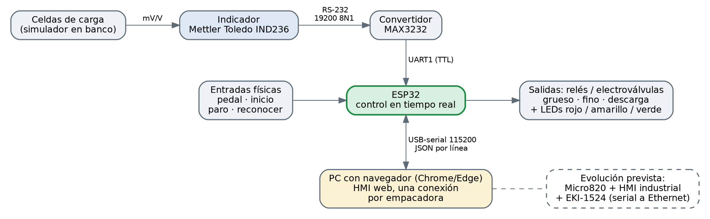
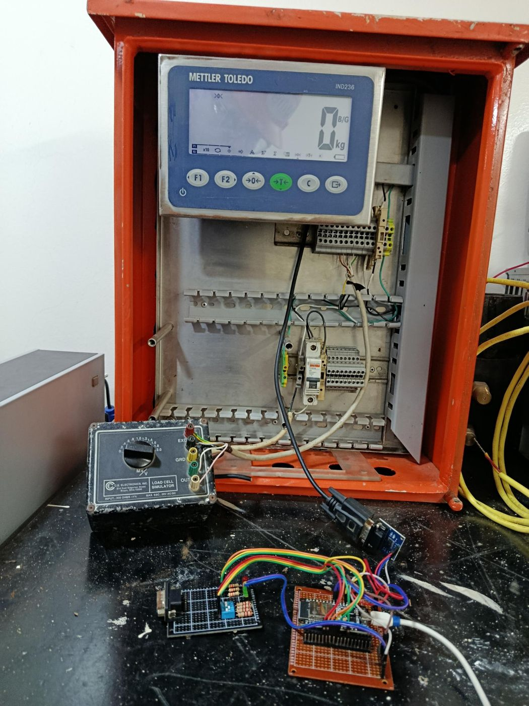

# Conexiones y hardware

## Componentes

| Componente | Función |
|---|---|
| Mettler Toledo **IND236** | Adquiere la señal de las celdas, muestra el peso y lo transmite en modo continuo (formato Toledo) por RS-232. |
| Simulador de celdas de carga (C.E. Electronics, 350 Ω, 0 a 2,0 mV/V) | Reproduce la señal de las celdas en las pruebas de banco, sin producto. |
| Módulo **MAX3232** | Adapta los niveles RS-232 del indicador a TTL (3,3 V) para el ESP32. |
| **ESP32** | Lee el peso, ejecuta la secuencia y los enclavamientos, acciona las salidas y habla con la HMI. |
| Placa de interruptores y LEDs | Simula pedal, inicio, paro y reconocer; LEDs rojo, amarillo y verde para las compuertas. |

## Asignación de pines (ESP32)

| Señal | GPIO | Tipo | Observación |
|---|---|---|---|
| IND236 vía MAX3232: **RX** / **TX** | 16 / 17 | UART1, 19200 8N1 | RX del ESP32 ← salida del MAX3232; TX del ESP32 → entrada del MAX3232 |
| Compuerta **gruesa** | 18 | Salida a relé | |
| Compuerta **fina** | 19 | Salida a relé | |
| **Descarga** | 21 | Salida a relé | |
| LED rojo (grueso) | 25 | Salida | Resistencia en serie |
| LED amarillo (fino) | 26 | Salida | Resistencia en serie |
| LED verde (descarga) | 27 | Salida | Resistencia en serie |
| Selector de **INICIO** | 32 | Entrada, pull-up interno | Activo en 0 |
| **PARO** | 33 | Entrada, pull-up interno | Activo en 0 |
| **Pedal** de descarga | 15 | Entrada, pull-up interno | Activo en 0; GPIO15 es un pin de arranque |
| **Reconocer** alarma | 13 | Entrada, pull-up interno | **Ajusta al GPIO real de tu cuarto interruptor** |
| HMI (USB-serial) | UART0 | 115200 | Solo JSON; logs apagados |

Los pines se definen al inicio de `firmware/src/control_logic.c` (entradas y salidas) y `firmware/src/ind236_driver.c` (UART del indicador).

## Notas de cableado

- **Entradas activas en bajo:** cada interruptor conecta el GPIO a GND; el pull-up interno del ESP32 mantiene el nivel alto en reposo. En planta usa contactos secos y aislamiento.
- **Salidas a relé:** el firmware pone el GPIO en alto para energizar. Si tus módulos de relé son activos en bajo, invierte la lógica o usa un transistor.
- **GPIO15 (pedal):** es un pin de arranque del ESP32. Con el pull-up interno suele funcionar, pero si el ESP32 no arranca con el pedal pisado, cambia el pin.
- **Masa común:** el MAX3232, el ESP32 y la placa de interruptores comparten GND.
- **Sensor óptico y banda:** quedan fuera del control; el conteo de sacos lo hace el sistema existente. En la HMI el sensor es solo ilustrativo.

## Configuración del IND236

El firmware espera la **salida continua en formato Toledo** a 19200 baudios, 8N1, con el peso sin punto decimal. Si la báscula muestra decimales (por ejemplo 50,0) pero la lectura llega como 500, ajusta `FACTOR_DECIMALES` en `firmware/src/ind236_driver.c`. Para una respuesta más rápida, configura la mayor velocidad de salida del indicador y el mayor baudrate compatible (ajusta `BAUD_SICS`). La configuración exacta del puerto está en el manual del IND236.
