# Diagnóstico de la planta

Fotos y hallazgos del sistema actual de cuatro empacadoras de sacos de 50 kg. Las imágenes se publican sin la dirección MAC de los equipos.

## Proceso actual

Cada empacadora tiene dos niveles. En el **piso superior** están la tolva, la compuerta de alimentación (cilindro neumático) y el balde de pesaje sobre una base en U. En el **piso inferior** están el ducto de descarga al saco y la banda transportadora. El **pesaje es por contrapeso**: al vencer el contrapeso, el balde presiona un microswitch que da por cumplidos los 50 kg. Otro microswitch, accionado por el pedal, habilita la descarga, y sin el interruptor de arranque no se llena ni se descarga. La banda la arranca el operador con un sistema aparte.

| | |
|---|---|
| 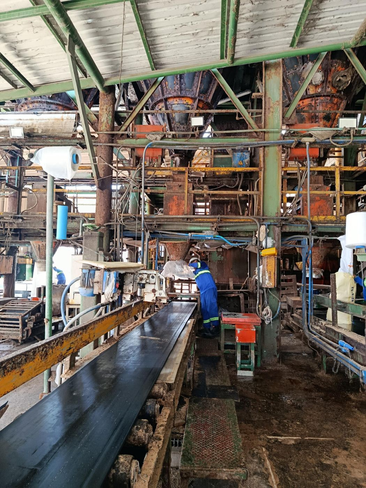 **1.** Vista general del área de empaque | 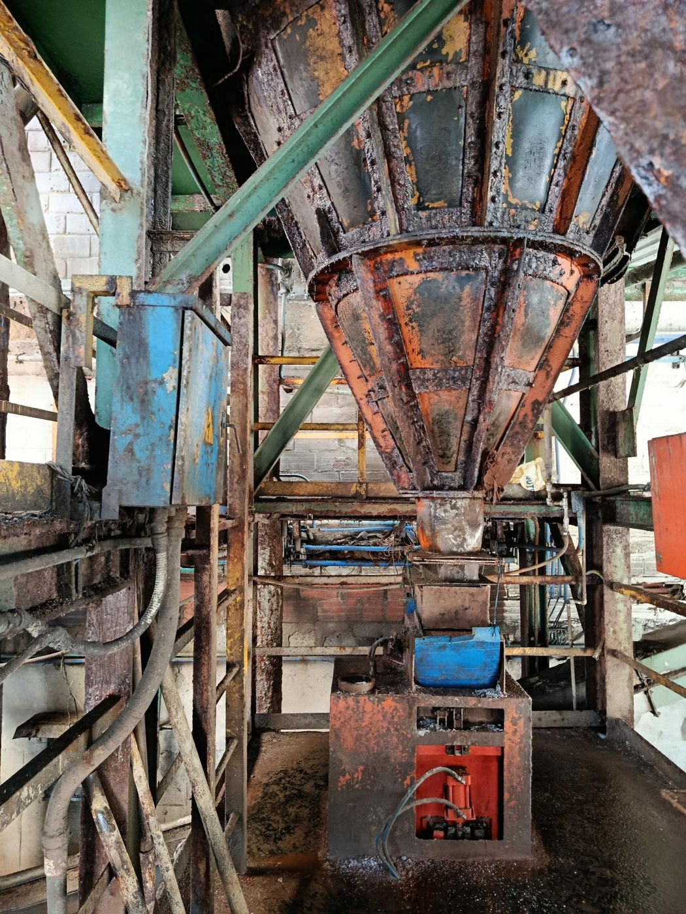 **2.** Piso superior: tolva, compuerta, balde y caja eléctrica |
| 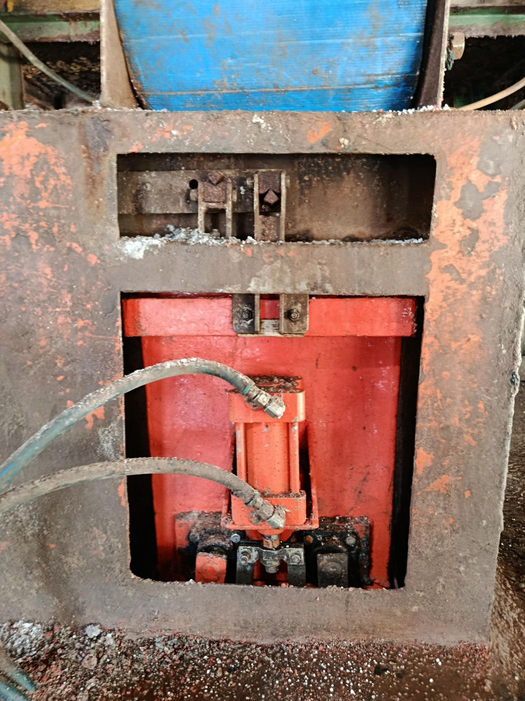 **3.** Base del balde con ventanas de inspección | 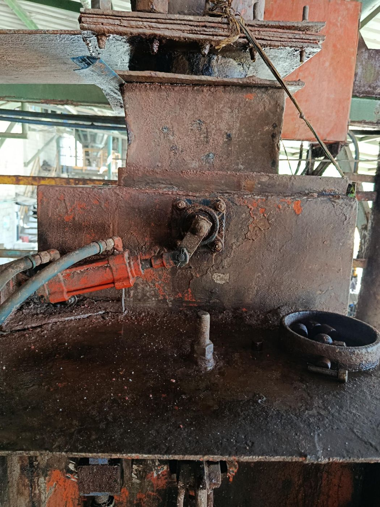 **4.** Cilindro neumático acoplado por palanca a la compuerta |
| 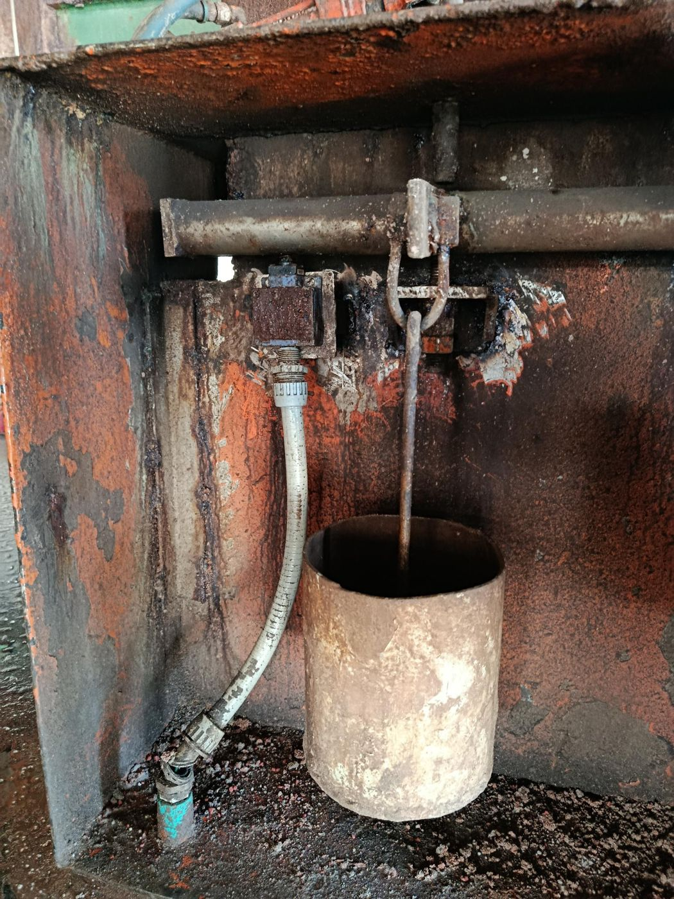 **5.** Microswitch y varilla suspendida del pesaje por contrapeso | 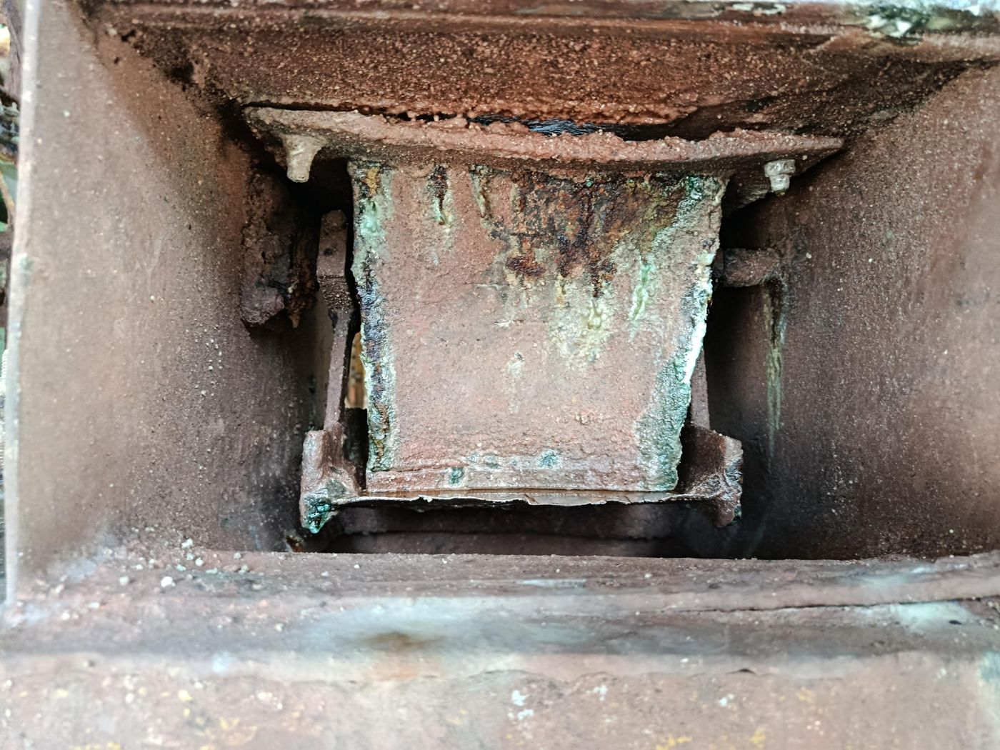 **6.** Interior de un ducto con corrosión severa y sales |
| 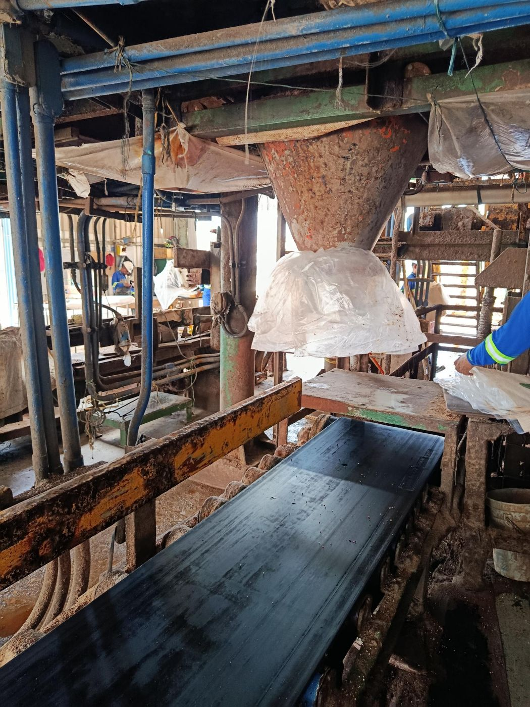 **7.** Piso inferior: ducto de descarga, saco y banda | 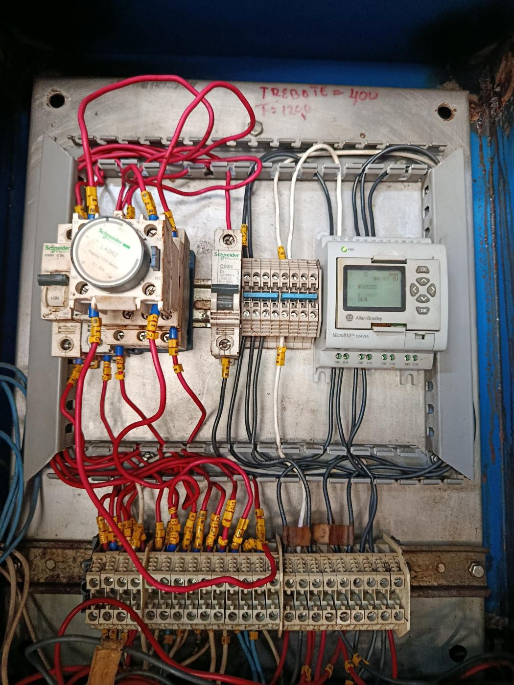 **8.** Tablero local: Micro810, temporizador LADR2 y anotaciones de tiempos |

## Tablero de totalización

El conteo de sacos se hace con sensores ópticos al final de la banda. Las señales llegan a un tablero con un **Micro820**, un servidor serial **EKI-1524** de cuatro puertos con salida Ethernet y una HMI Allen-Bradley que muestra los totalizadores por turno y generales. Los contadores se reinician con tarjetas RFID por empacadora.

| | |
|---|---|
| 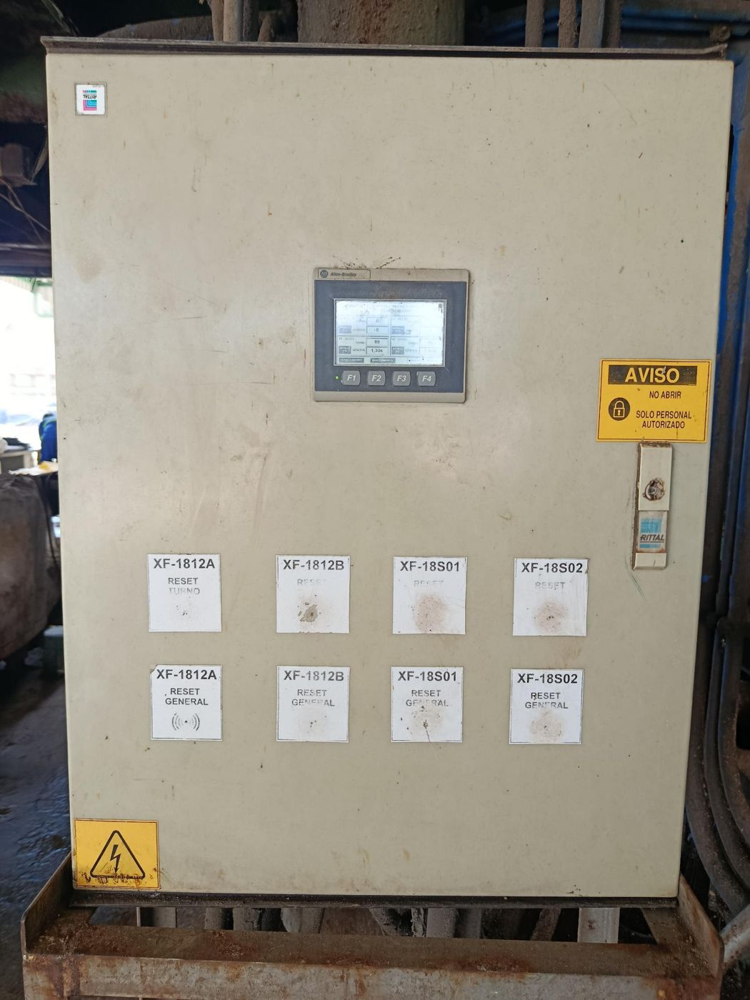 **9.** Frente del tablero: HMI y etiquetas RFID | 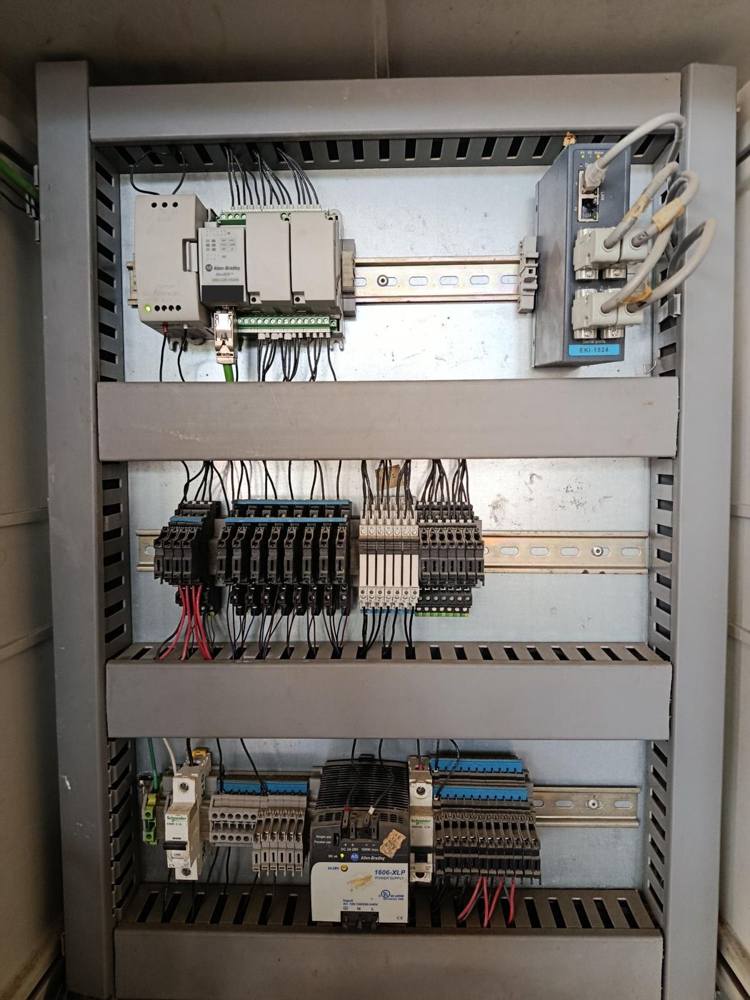 **10.** Interior: Micro820, EKI-1524, relés y fuente de 24 V |
| 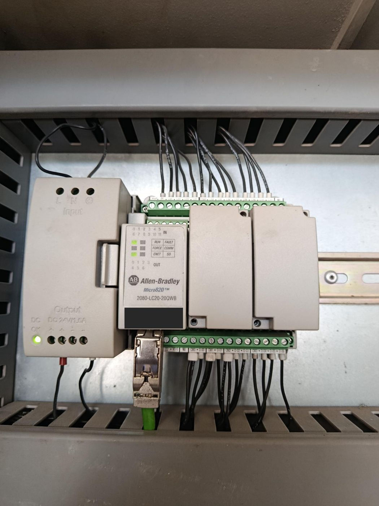 **11.** Micro820 con las ranuras de expansión cubiertas | 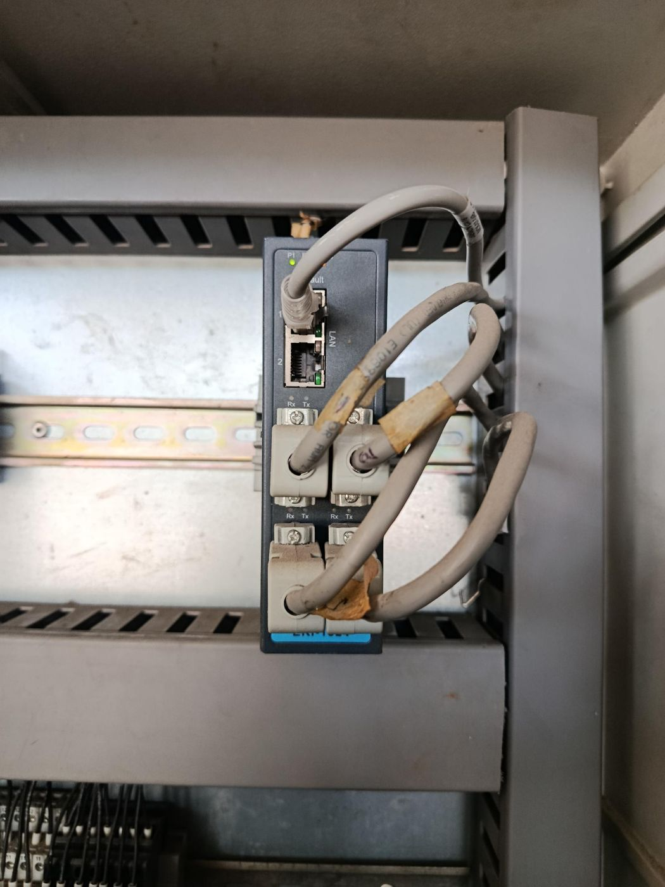 **12.** EKI-1524, servidor serial de cuatro puertos |

## Inventario de equipos observados

| Equipo | Ubicación |
|---|---|
| PLC Allen-Bradley **Micro810** (12AWA) | Tablero local de la empacadora |
| Temporizador Schneider **LADR2** y minidisyuntores | Tablero local |
| PLC Allen-Bradley **Micro820** (2080-LC20-20QWB) | Tablero de totalización |
| Servidor serial **EKI-1524** (4 puertos) | Tablero de totalización |
| Fuente Allen-Bradley **1606-XLP** (24 V) | Tablero de totalización |
| HMI Allen-Bradley con totalizadores y etiquetas RFID | Frente del tablero de totalización |

## Hallazgos

- **Precisión limitada:** el peso se infiere de un único disparo mecánico que depende del ajuste del contrapeso; no se mide ni se registra el peso real de cada saco.
- **Corrosión severa** en soportes, mecanismos de disparo, ductos, mangueras y tableros, con fallas de contacto y desajustes.
- **Lógica dispersa:** microswitches, contactor con temporizador y PLC, con tiempos ajustados a mano (en el tablero se ve la anotación manuscrita "TREBOTE = 400" y "T = 1200").
- **Sin trazabilidad ni supervisión integrada** de pesos, estados y alarmas.
- **Capacidad instalada sin aprovechar:** entradas, salidas, relés y ranuras de expansión del Micro820 y puertos del EKI-1524.

## Recomendaciones para el entorno corrosivo

- Celdas de carga **selladas y de acero inoxidable**.
- Gabinetes **IP66** o de acero inoxidable, con prensaestopas y sellos adecuados.
- **Recubrimiento protector** en las tarjetas electrónicas y tubería flexible hermética.
- Reemplazar los microswitches expuestos por sensores con carcasa sellada.
- Plan de limpieza e inspección periódica de los tableros.
- Revisar con el área de seguridad y salud en el trabajo la clasificación del área por polvo.
