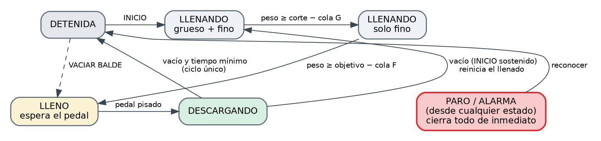

# Firmware

C con **ESP-IDF** (FreeRTOS), proyecto de PlatformIO en `firmware/`.

## Tareas

| Tarea | Prioridad | Función |
|---|---|---|
| `task_ind` | 12 | Recibe la trama del IND236 **byte a byte** (sin esperas) y despierta al control al llegar cada peso. |
| `task_control` | 11 | Ciclo tipo PLC: comandos → entradas → peso → paro → alarmas → secuencia → enclavamientos → salidas → HMI. Corre como máximo cada **10 ms**. |
| `task_hmi_rx` | 5 | Recibe los comandos JSON de la HMI por UART0 y los encola; guarda en flash fuera del ciclo de control. |

Los comandos de la HMI pasan por una cola y se ejecutan **dentro del ciclo de control**, así que no hay condiciones de carrera con las salidas.

## Secuencia

1. **INICIO** (selector físico o HMI): abren grueso y fino.
2. Al llegar a `corte − cola grueso` cierra el grueso; sigue el fino.
3. Al llegar a `objetivo − cola fino` cierra el fino y queda **LLENO**, esperando el pedal.
4. **Pedal pisado** (por nivel): descarga. Sigue aunque se suelte el pedal hasta vaciar el balde (`peso ≤ 1 kg`), con un mínimo de 1,5 s y un máximo de 15 s.
5. Con INICIO sostenido (selector activo o INICIO desde la HMI) vuelve a llenar solo; si no, queda detenida.

**VACIAR BALDE** (modo automático, detenida): deja el balde esperando el pedal y descarga hasta vaciar, sin reiniciar el llenado.

## Enclavamientos (por nivel, prioridad absoluta)

Se calculan en cada ciclo y actúan en el mismo ciclo, sin esperar la secuencia:

| Condición | Efecto |
|---|---|
| **PARO** (físico o HMI) | Cierra todas las salidas y deja la secuencia detenida |
| Peso inválido (sin trama en 500 ms) | Bloquea el llenado |
| **Sobrellenado** (peso > objetivo + 10 %, mínimo 2 kg) | Bloquea el llenado |
| Alarma activa | Bloquea el llenado |
| Descarga abierta | Cierra el llenado (nunca llena y descarga a la vez) |

## Alarmas

| Código | Alarma | Condición |
|---|---|---|
| 1 | Sobrellenado | Peso por encima del límite |
| 2 | Sin lectura de peso | Llenando sin tramas del IND236 durante 500 ms |
| 3 | Tiempo de llenado excedido | Más de 60 s llenando |
| 4 | Descarga incompleta | Más de 15 s descargando sin vaciar |

Las alarmas **se enganchan por flanco** y se reconocen con el botón físico o desde la HMI. No se vuelven a disparar mientras la condición persiste; los enclavamientos por nivel siguen protegiendo. Con alarma de sobrellenado se puede **descargar en manual con el pedal** para vaciar el balde.

## Parámetros

Constantes al inicio de `main.c`: `SCAN_MS`, `PESO_TIMEOUT_MS`, `PESO_VACIO`, `LLENADO_MAX_MS`, `DESC_MIN_MS`, `DESC_MAX_MS`, `HMI_PERIODO_MS` y `MANUAL_REQUIERE_PESO` (déjalo en 1 en producción; en 0 permite probar compuertas sin IND236).

Ajustes guardados en memoria no volátil (NVS) y editables desde la HMI: peso objetivo, corte de grueso, cola de grueso, cola de fino, cero y span.

## Cero, span y colas

- **Cero:** con el balde vacío, **CERO** toma el peso actual como referencia. Si pones cero en el indicador, vuelve a presionarlo en la HMI.
- **Span:** con un peso patrón en el balde, escribe su valor y presiona **SPAN**.
- **Colas:** es el producto en vuelo después de cerrar la compuerta. Anota el peso al que cierra cada compuerta y el peso final estabilizado; la cola es la diferencia. Ajusta de a poco y repite.

## Opcional: tick de 1 ms

`firmware/sdkconfig.defaults` fija `CONFIG_FREERTOS_HZ=1000`. Si ya tienes un `sdkconfig.<env>` generado, bórralo para que se regenere.
