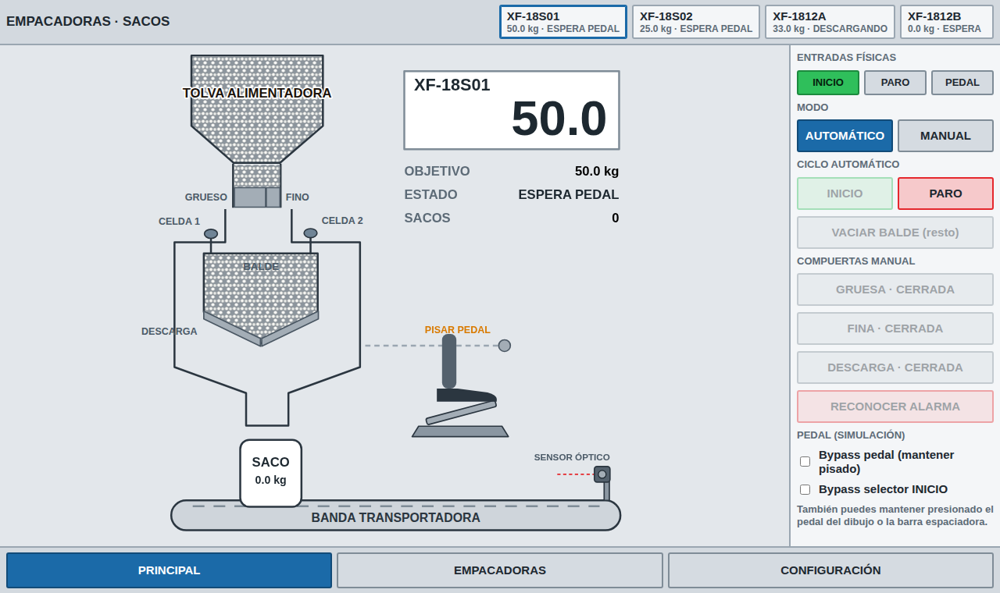
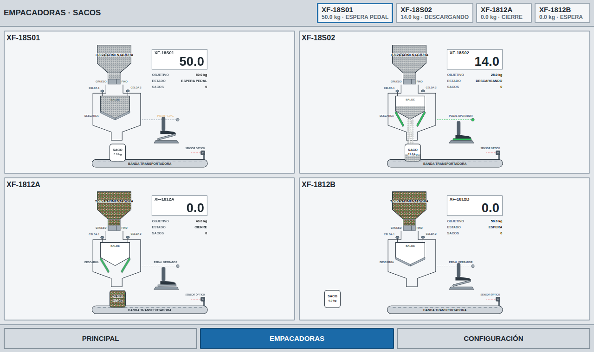
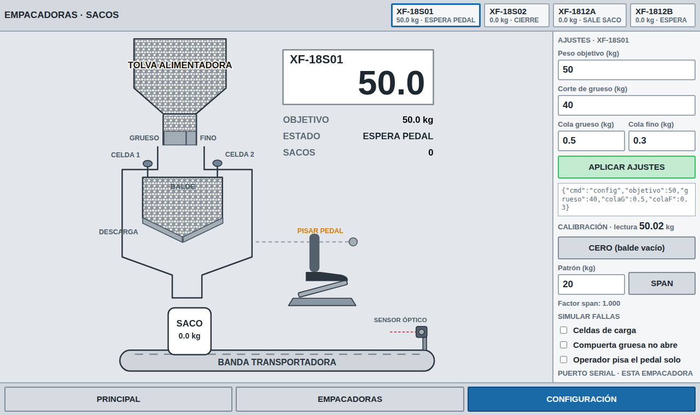

# HMI web

Un solo archivo (`index.html`), sin dependencias que instalar. Estilo SCADA/HMI claro, pensado para pantallas pequeñas.

## Pantallas

- **Principal:** esquema de la empacadora seleccionada (tolva, compuertas grueso y fino, balde con nivel proporcional al objetivo, celdas de carga, compuertas de descarga, saco, banda, pedal del operador y sensor óptico), con modo manual/automático, INICIO/PARO, VACIAR BALDE, compuertas manuales, reconocer alarma, bypass y el estado de las entradas físicas.
- **Empacadoras:** las cuatro máquinas a la vez.
- **Configuración:** peso objetivo, corte de grueso, colas, cero y span, puerto serial y baudios **por empacadora**, y simulación de fallas.

| Empacadoras | Configuración |
|---|---|
|  |  |

## Convenciones

- Compuerta **gris** = cerrada, **verde** = abierta, **roja** = falla. Las celdas de carga se ponen rojas si fallan.
- El producto se dibuja como gránulos: blancos en las dos primeras máquinas y en mezcla de tres colores en las otras dos (se cambia con `p.kind` en el código).
- Pedal: mantén presionado el pedal del dibujo o la **barra espaciadora**; también hay un bypass en el panel.

## Uso con el ESP32

1. Abre el archivo en **Chrome o Edge** (Web Serial exige un navegador compatible y una página abierta desde archivo local, `localhost` o HTTPS).
2. Configuración → elige la empacadora → baudios 115200 → **Elegir puerto y conectar**.
3. Mientras esté conectada, esa empacadora deja de simularse y muestra los datos reales. Cada empacadora usa su propio puerto.

El formato de los mensajes está en [../docs/protocolo.md](../docs/protocolo.md).

## Personalizar

- **Tags de las empacadoras:** constante `TAGS` en el script (`XF-18S01`, `XF-18S02`, `XF-1812A`, `XF-1812B`).
- **Publicarla en la web:** GitHub Pages sirve por HTTPS, así que Web Serial funciona. Activa Pages desde la carpeta `/docs` y copia `index.html` a `docs/hmi/`.
